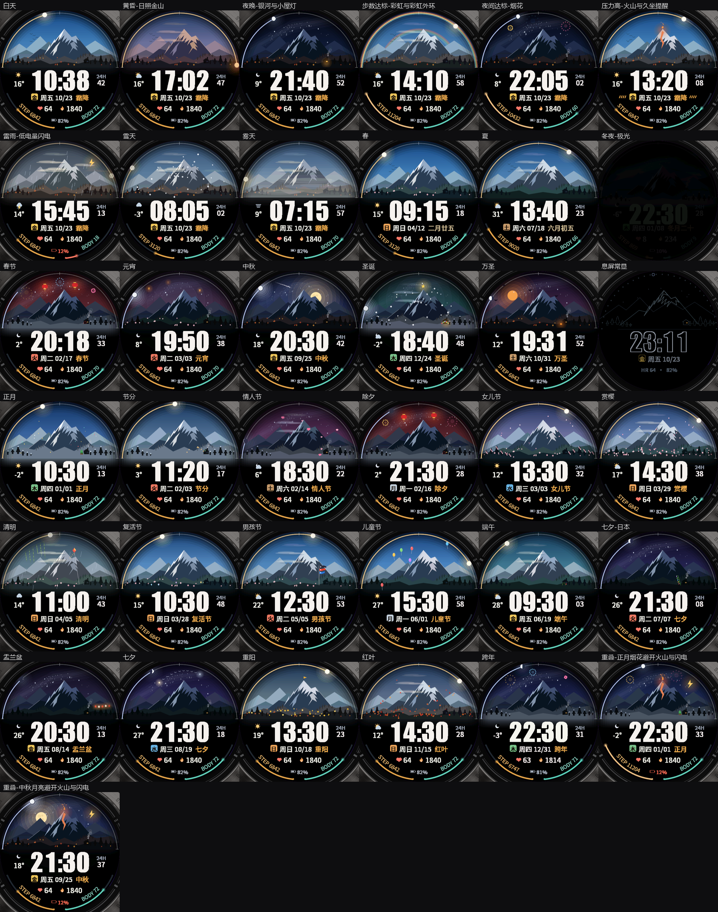

# 山境 / Mountain

佳明 **EPIX Pro（Gen 2）51mm**（454 × 454 AMOLED）的原生数字表盘，用 Connect IQ / Monkey C 编写。

- **上半部分是山景**：随真实的日出日落、天气、季节，以及 22 个中国、日本和国际节日变化。
- **下半部分是信息区**：时间、日期（七曜印章、节气、农历）、心率、卡路里、电量。
- **表圈**：上半是太阳进度环，下半是步数和身体电量两段弧。



上图是原生模拟器里 37 个场景的实际截图，单张图在 [`预览图/`](预览图)。每一版具体改了什么，见 [改版说明.md](改版说明.md)。

## 功能

- **真实的天色**：按手表 GPS 算出的日出日落切换清晨、白昼、黄昏、夜晚。黄昏时主峰「日照金山」；夜里有真实月相、银河，满月时天空更亮，冬季晴夜偶尔有极光。
- **天气入景**：晴、云、雨、雪、雾、雷雨直接画进山景。
- **数据入景**：
  - 步数达标：白天出彩虹，夜里放烟花
  - 压力高：主峰变成火山
  - 低电量或充电中：天空出现闪电
  - 有未读消息：小屋亮灯
  - 久坐：日期两侧出现提醒条
- **22 个活动日**：
  - 中国：春节、元宵、清明、端午、七夕、中秋、重阳、除夕
  - 日本：正月、节分、女儿节、赏樱、男孩节、七夕、盂兰盆、红叶
  - 国际：情人节、复活节、儿童节、万圣节、圣诞、跨年
  - 每个都有专属的天色、装饰和动画，同屏元素互不遮挡
- **动效**：
  - 抬腕开场：山景升起，时间滑入，读数从 0 跳到当前值，两段弧扫开，太阳沿表圈走到位
  - 常亮期间：云朵飘过，爱心按实时心率跳动，太阳光晕呼吸；还有飞鸟、流星、炊烟和各种节日动画
- **息屏常显**：整幅画面的细线稿，亮像素约 7%，每分钟换位防烧屏。
- **设置**：在手表上长按表盘进入，可调天空、天气入景、动效（丰富 / 简洁 / 关闭）、节日天空、强调色；手机 Connect IQ 里还能调火山和低电量的阈值。

## 预览

- [`preview.html`](preview.html)：浏览器版，和原生代码逐函数对应。可切换时间、天空、天气、状态和活动日，点「抬腕」按手表节奏播放动画。需要先生成字库（见下文），再用本地服务器打开，例如 `python -m http.server` 后访问 `http://localhost:8000/preview.html`。
- `python make_preview.py` 可以生成一个可直接双击打开的单文件预览页 `山境-打开预览.html`。它内嵌字库，所以不放进仓库。

## 构建

需要：
- Windows（时间数字的 Impact 字体取自系统，见「字体与授权」）
- [Connect IQ SDK](https://developer.garmin.com/connect-iq/sdk/) 9.x，并用 SDK Manager 下载 EPIX Pro 51mm 的设备文件
- 你自己的 Connect IQ 开发者密钥（`.der`）
- Java 17、Python 3 + Pillow
- Node：只有重新生成农历表时需要

`ciq.py` 默认在同级目录 `../watchface-install` 里找 SDK（`sdk/bin`）和密钥（`developer_key.der`），也可以用环境变量指定：`CIQ_SDK`（SDK 目录，内含 `bin/`）、`CIQ_KEY`（密钥路径）、`CIQ_JAVA`（java.exe）。

先生成资源（字库、山景几何、节气农历表），克隆后至少要运行一次：

```bash
python generate_assets.py
```

编译正式版，输出 `build/Mountain.prg`：

```bash
python build.py
```

其他脚本：

| 命令 | 作用 |
| --- | --- |
| `python test_native.py` | 在模拟器里跑渲染单元测试（先启动 SDK 的 `simulator.exe`） |
| `python capture_sim.py` | 用演示版在模拟器里轮播全部场景并截图，存到 `build/sim/` |
| `python build.py diag` | 带帧耗时日志的诊断版，输出 `build/diag/Mountain.prg` |
| `pwsh -File install_watch.ps1` | 通过 USB 把正式版装到手表；`-Diag` 装诊断版并打开日志，`-Pull` 取回日志 |
| `python make_preview.py` | 生成单文件预览页 |
| `python package_release.py` | 打包成 zip，不含签名密钥 |

代码结构：

| 文件 | 内容 |
| --- | --- |
| `source/Scene.mc` | 画面。山景层只在天色变化时重画，每分钟层（山景、文字、表圈）每分钟画一次，动画帧只叠加会动的元素 |
| `source/Hud.mc` | 文字与图标 |
| `source/Model.mc` | 数据读取：复杂功能优先，取不到时回退到传感器历史 |
| `source/Cal.mc` | 节气与农历 |
| `source/Events.mc` | 活动日：日期判定、天色、装饰与动画 |
| `source/Generated.mc` | 由 `generate_assets.py` 生成：字体度量、山景几何、节气农历表 |
| `preview-render.js` | 与原生代码逐函数对应的浏览器版 |

## 安装到手表

1. 手表用 USB 连接电脑。
2. 把 `build/Mountain.prg` 复制到手表的 `GARMIN/Apps`，或者运行 `install_watch.ps1`。
3. 安全断开。
4. 在表盘列表里选「山境 Mountain」。

## 字体与授权

- **代码**：[GPL-3.0](LICENSE)。
- **中文与数据字体**：Noto Sans SC，[SIL Open Font License 1.1](licenses/NotoSansSC-OFL.txt)。由它生成的字库在 `resources/fonts/` 里。
- **时间数字**：Impact，是 Windows 自带的商业字体，**不随仓库分发**。克隆后运行 `generate_assets.py`，会从本机的 `C:\Windows\Fonts\impact.ttf` 生成 `TimeFont` 和 `TimeLine`。如果没有 Impact，可以在 `generate_assets.py` 的 `fonts()` 里换成别的字体，比如 Anton（OFL）。
- **v1**：`archive/v1/` 里 v1 用到的 Impact 和 Bahnschrift 字库同样不在仓库里。

## 致谢

- **v1 原版**由 **Astra** 制作，完整保存在 [`archive/v1/`](archive/v1)。v2 沿用了它的山形和上山下字的结构。
- 设计方向参考了表盘「望山-X」，没有使用它的代码或美术资源。

## 验证情况

- **已验证**：原生编译；模拟器渲染单元测试（全部天空、天气、季节、活动日、开场帧、缺数据、息屏，以及节气、农历和活动日日期断言）；37 个场景的模拟器截图。
- **真机**：已在 EPIX Pro 51mm（固件 27.18）上运行，画面、抬腕开场、常亮动效和手表端设置菜单都正常。
- **尚未系统验证**：续航，以及复杂功能数据在各种情况下的取值。
